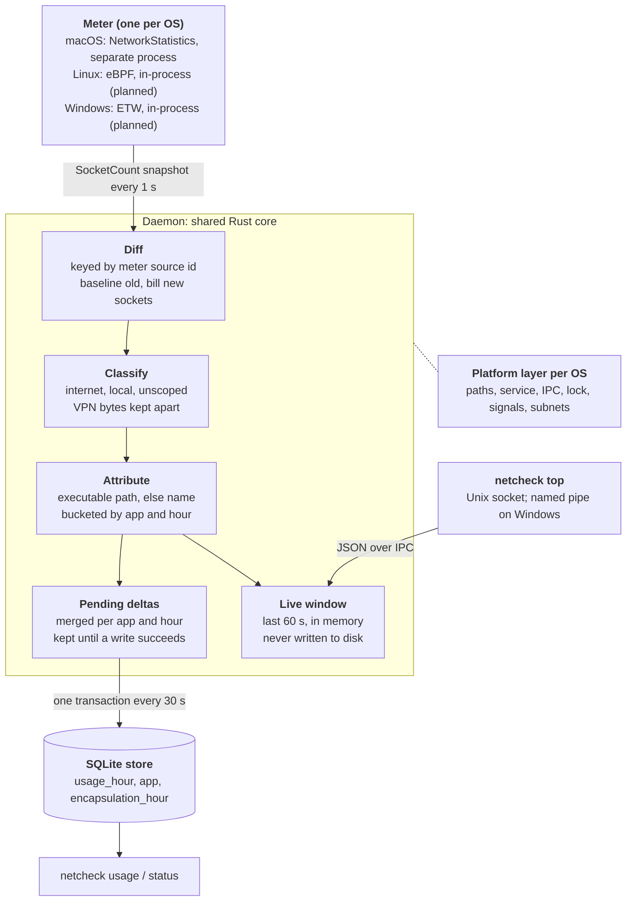

# netcheck — Design

Last updated: 2026-11-01

## Goal and scope

netcheck records how much each app sends and receives, split into internet, local network, and unscoped traffic, using a native, low-overhead background daemon. macOS ships first; Linux and Windows follow, then a GUI dashboard on the same data.

**In scope**

- Per-app totals by hour, kept locally in SQLite.
- A live view of the last minute (`netcheck top`).
- One shared core (diff, classification, storage, live window) with a native meter per OS.
- Runs unattended as a service, survives meter crashes, and restarts on login or boot.

**Out of scope for now**

- Packet capture, per-domain or per-URL breakdowns, and traffic shaping or blocking.
- Remote collection or multi-machine aggregation.
- Billing-grade accuracy. The target is trustworthy per-app totals, within a few seconds of start-up loss.

**Lowest overhead is the deciding criterion.** When designs compete, the one with less CPU, fewer wakeups and less memory wins, even if it adds a language such as C.

**Overhead budget (macOS today):** about 4 MB for the daemon and 7 MB for the meter, idle CPU near 0%, one SQLite transaction every 30 s, and one status-file write every 10 s. Each meter is measured the same way: CPU seconds per hour and wakeups per second, idle and during a saturating transfer.

## Current state: macOS v1

macOS v1 is running as a per-user LaunchAgent, and its accounting was verified against known loopback transfers on 2026-11-01 (commit `315d2aa`).

| Command | What it does |
| --- | --- |
| `netcheck daemon` | Runs the meter and records usage (started by the LaunchAgent) |
| `netcheck usage --since 24h [--app X] [--by-exe] [--json]` | Hourly totals per app (helpers included), or per executable with `--by-exe` |
| `netcheck top [--json]` | Off-machine usage over the last 60 s, read from the daemon over a Unix socket |
| `netcheck status` | Meter state, last sample and flush times, stored row count |
| `netcheck install` / `uninstall` | Installs or removes the LaunchAgent and its binaries |

**Accuracy checks (loopback, temp database)**

| Case | Before `315d2aa` | After |
| --- | --- | --- |
| 5 short 3 MB fetches by a process that predates the daemon | 0 B | 15 MB, plus the server's 15 MB sent |
| 30 MB transfer already running at daemon start | not tested | about 22.35 MB, only what arrived after start |
| `curl` started after the daemon | 3 MB | 3 MB |
| Second daemon on the same database | ran and double-counted | refused |

Files live in `~/Library/Application Support/netcheck/`: `netcheck.db`, `status.json`, `netcheck.sock`, `netcheck.lock`, and `bin/`.

## Architecture

A per-OS meter feeds socket snapshots to one shared daemon, which turns them into per-app usage. Only the meter and a thin platform layer differ between operating systems.



The daemon diffs each snapshot, classifies and attributes the bytes, then sends them two ways: to SQLite every 30 s for history, and to a 60 s in-memory window for `top`. If the meter crashes, the daemon restarts it with backoff and resets its flow state.

## Meter contract

Every meter delivers, about once a second, a full snapshot of live sockets as `SocketCount` records with cumulative counters. That contract is what makes the core platform-independent. The NC02 byte frame is only how the macOS meter sends it.

| Field | Meaning | Rule |
| --- | --- | --- |
| `source` | Meter-assigned socket id | Unique for one meter run; never reused in that run |
| `new` | No bytes in these counters predate the meter | True for sockets opened after the first snapshot; false for sockets that already existed |
| `rx`, `tx` | Bytes received and sent | Cumulative from the later of socket open or meter start; never decrease |
| `pid`, `start_time` | Owning process and its start time (Unix s) | Captured when the meter first sees the socket |
| `path` | Executable path | Captured on first sight; absent if the process was already gone |
| `name` | Process name (up to 64 bytes) | Fallback identity when `path` is absent |
| `proto` | TCP or UDP | Other protocols are dropped |
| `local`, `remote` | Socket addresses | Latest known; may change during the socket's life; `remote` absent for unconnected UDP |

**Lifecycle rules**

1. A closed socket appears in exactly one more snapshot with its final counters, then disappears.
2. Snapshots are complete: a live socket missing from a snapshot is treated as gone.
3. A meter restart starts a new run: ids restart, and the daemon resets its flow state (`Engine::reset_flows`).

**How the daemon turns this into usage:** first sight of a `new` socket bills its full counters; first sight of an old socket records a baseline; every later sight bills the increase. Event-based meters (Linux eBPF, Windows ETW) satisfy the contract by summing deltas per socket from attach time and marking every socket `new`.

**NC02 frame (macOS):** a `NC02` magic header, then length-prefixed messages: snapshot start, one socket record per socket (142 fixed bytes plus a path of up to 4,096 bytes), and snapshot end with a count. Little-endian throughout.

## Data model and storage

Usage is stored as per-app hourly buckets in SQLite (WAL, `synchronous=NORMAL`), so the database stays small and queries stay simple. The cost is that `usage --since` rounds out to whole hours.

| Table | Key | Columns |
| --- | --- | --- |
| `app` | `id`; `app_key` unique | `display_name`, `group_key` (indexed), `group_name` |
| `usage_hour` | (`app_id`, `hour_utc`) | `internet_rx/tx`, `local_rx/tx`, `unscoped_rx/tx` (bytes) |
| `encapsulation_hour` | `hour_utc` | `rx`, `tx`: VPN tunnel bytes kept out of app totals |

- **App identity:** `app_key` is the executable path. With no path, it's `name:<process name>`, so short-lived processes still group. 21 older `pid:<pid>:<start>` rows from before `315d2aa` remain and are grouped by process name.
- **App grouping:** `group_key` is the outermost `.app` or `.appex` bundle in the path, so helpers count toward their app (`/Applications/Claude.app` → Claude). Other executables are their own group. Grouping rules for Linux and Windows aren't written yet. `usage` and `top` show groups; `usage --by-exe` shows executables.
- **Durability:** deltas are merged in memory per app and hour, then written every 30 s in one transaction. A failed write keeps them for the next try. Up to 30 s is lost on a crash or `SIGKILL`.
- **Off-machine** = internet + unscoped. It's what `top` shows and what the default `usage` sort uses.
- **Schema versioning:** the version lives in `PRAGMA user_version` (currently 2). The daemon applies ordered migrations on start, each in its own transaction. The CLI opens read-only and refuses an old schema with "restart the daemon". v1 is the original tables; v2 adds the group columns and fills them for existing rows.
- **No retention policy.** At roughly 100 apps × 24 hours, that's about 2,400 small rows a day, so growth is slow but unbounded.

## Classification and attribution

Each socket's bytes go to one scope based on its remote address, and to one app based on its executable path.

| Scope | Rule |
| --- | --- |
| Local | Remote is loopback, RFC 1918 private, link-local, multicast, broadcast, unspecified, IPv6 ULA (`fc00::/7`) or link-local (`fe80::/10`), or inside a subnet configured on this machine (refreshed every 60 s) |
| Local (no remote) | Local port is DHCP 68, NetBIOS 137/138, SSDP 1900, or mDNS 5353 |
| Unscoped | No remote address and none of those ports, typically unconnected UDP |
| Internet | Everything else |

**VPN encapsulation:** traffic from processes named `mullvad-daemon`, `mullvad vpn`, `openvpn`, `wireguard-go`, `wireguard` or `wg` goes to `encapsulation_hour`, not to app totals. The tunnelled traffic is already counted under the apps that sent it, so this avoids counting it twice.

**Known attribution gaps**

- **Helper processes outside bundles:** helpers inside an `.app` now group with it on macOS, but standalone binaries and Linux and Windows processes don't group yet.
- **Delegated traffic:** some apps hand networking to another process, such as Safari to `com.apple.WebKit.Networking` or background transfers to `nsurlsessiond`. NStat reports an effective PID that could credit the right app; it isn't used yet.
- **Shared interpreters:** every Python or Node script lands under one interpreter row.
- **CGNAT and Tailscale:** peers in `100.64.0.0/10` count as internet, and they're double-counted against `tailscaled`'s own sockets. `tailscaled` isn't on the exclude list.
- **Fixed exclude list:** it's hard-coded and matches process names only.

## Platform plans

Each OS gets the one source that sees every socket, including UDP and connections shorter than a poll. On Linux and Windows that source needs root or admin, so the daemon there becomes a system service. Linux and Windows details are from API knowledge and haven't been prototyped.

|  | macOS (shipped) | Linux (planned) | Windows (planned) |
| --- | --- | --- | --- |
| Source | NetworkStatistics (private framework) | eBPF: `tcp_sendmsg`, `tcp_cleanup_rbuf`, UDP send and receive paths | ETW `Microsoft-Windows-Kernel-Network` |
| Data shape | Cumulative per socket | Per-event deltas, summed per socket in a BPF map | Per-event deltas, summed per connection |
| Socket id | Meter counter | Socket cookie (unique per boot) | Meter counter per 5-tuple and PID |
| Close signal | Removed callback | `inet_sock_set_state` to closed | Disconnect event |
| Privilege | User | Root (`CAP_BPF`, `CAP_PERFMON`) | Administrator |
| Minimum | macOS 13+ assumed | Kernel 5.8+ with BTF | Windows 10 1809+ assumed |
| Runs as | LaunchAgent | systemd system unit | Windows service |
| Meter process | Separate (Objective-C) | In-process Rust loader; probe language open (decision 5) | In-process Rust; consumer design open (decision 6) |

**Rejected sources:** Linux `sock_diag` polling (no UDP byte counters, misses short connections); Windows TCP ESTATS (TCP only, polled), WFP callout drivers (need a signed kernel driver), and SRUM (hourly and delayed).

**Platform layer:** these pieces sit behind one small interface in `src/platform/`, with one module per OS. macOS is complete. The Linux and Windows modules are stubs that return "not supported yet", and they haven't been compiled for those targets. The instance lock uses `std::fs::File::try_lock` on every OS.

| Concern | macOS | Linux | Windows |
| --- | --- | --- | --- |
| Data directory | `~/Library/Application Support/netcheck` | `/var/lib/netcheck` | `%ProgramData%\netcheck` |
| Service install | `launchctl` | systemd unit | Service Control Manager |
| IPC for `top` | Unix socket | Unix socket | Named pipe |
| Instance lock | `flock` | `flock` | `LockFileEx` or a named mutex |
| Stop signal | `SIGINT`, `SIGTERM` | `SIGINT`, `SIGTERM` | Service control handler |
| Local subnets | `getifaddrs` | `getifaddrs` | `GetAdaptersAddresses` |
| App grouping | `.app` bundle | systemd `app-*.scope`, Flatpak id | Package family name, service name |

**Platform-specific traps**

- **Linux:** kernel WireGuard has no process, so nothing to exclude. Containerised processes need `/proc/<pid>/root` to resolve paths.
- **Windows:** ETW can drop events under load, so the status file should report lost events. Some traffic is credited to PID 4 (System), such as SMB. `svchost.exe` needs service-level attribution.

## Decision log

These are settled unless new evidence reopens them. Newest first.

| When | Decision | Why | Rejected |
| --- | --- | --- | --- |
| Decided 2026-11-01 | Lowest runtime overhead decides between designs; other languages (C or others) are allowed where they lower it | A native, low-overhead daemon is the product goal | A single-language codebase as a constraint |
| Decided 2026-11-01 | No CI for now; the conformance suite runs locally | Not worth the setup at this stage | A GitHub Actions matrix |
| Decided 2026-11-01, not built | Linux and Windows run as a system service with a system-wide database readable by a `netcheck` group; IPC checks peer credentials. macOS stays a per-user LaunchAgent | eBPF and ETW need root or admin; a group keeps reads off root without a second process | Privileged meter feeding a per-user daemon; root-only reads |
| Built 2026-11-01 | The macOS meter records each executable's UUID with its path, and uses it to name processes that exit before their path can be read | The conformance suite showed a process living under one poll lost its path in 2 of 3 runs | A process-name lookup, which can't tell two binaries with the same name apart |
| Built 2026-11-01 (macOS) | Linux and Windows meters run in-process behind a `Meter` trait; the macOS subprocess becomes one implementation of it | Privilege separation was the main reason for a separate process, and the service model doesn't need it | A separate meter process on every OS |
| Built 2026-11-01 | Schema versioning with `PRAGMA user_version` and ordered migrations, plus a `group_key` column set at write beside the raw `app_key` | Only one database to migrate today; the GUI needs grouping | Grouping applied at query time only |
| Decided 2026-11-01 | Linux is the next platform, then Windows | eBPF matches the meter contract directly, and Ubuntu CI runners can run it with `sudo` | Windows first |
| `315d2aa` | Key flows by meter source id, not by address tuple | Addresses change during a socket's life; a tuple key split or dropped flows | 5-tuple plus PID key |
| `315d2aa` | The meter flags sockets opened after its first snapshot as `new`; the daemon bills their full counters | Only sockets that predate the meter need a baseline; the old rule lost short connections from long-running apps | Baseline every first sight; bill by process start time |
| `315d2aa` | The meter captures path and start time on first sight | Short-lived processes exit before the daemon can look them up | Daemon-side `proc_pidpath` lookup |
| `315d2aa` | Single instance per database via `flock` | Two daemons silently stole the socket and double-counted | PID file |
| `315d2aa` | Pending deltas merged per app-hour, flushed in one transaction, kept on failure | No loss or double counting on database errors; bounded memory during an outage | Per-hour transactions; drop on failure |
| `315d2aa` | `install` stops the agent, then replaces binaries by rename | Writing into a running Mach-O on arm64 leaves a stale code signature, and the next launch is killed | In-place copy |
| `a2cc1b7` | Live `top` window kept in memory and served over a Unix socket | Avoids per-second database writes | Querying SQLite for live data |
| `a2cc1b7` | Per-user LaunchAgent on macOS | NStat works without root and sees every user's sockets | LaunchDaemon (root) |
| `6dd9026` | Meter as a separate process that streams frames | Isolates the private Objective-C framework; a crash restarts only the meter | Linking NStat into the Rust binary |
| `6dd9026` | Hourly buckets in SQLite, three scopes, VPN bytes kept apart | Small and simple to query; scopes answer "what went to the internet" | Per-flow rows; a time-series database |

## Open decisions

Decisions 5–8 shape the meters, so settle them before the first port. Decision 2 should be settled before the GUI starts, since it shapes the IPC API. The recommendations are proposals, not decisions.

| # | Decision | Options | Recommendation | Blocks |
| --- | --- | --- | --- | --- |
| 1 | Contract fields to add now | Interface class (Wi-Fi, wired, cellular, tunnel, loopback); effective PID | Add both as optional fields; fill on macOS first | Metered-connection tracking, Safari and WebKit attribution |
| 2 | How the GUI reads data | Directly from SQLite; through a versioned daemon API over IPC | Daemon API, so the schema can change underneath | IPC design, GUI |
| 3 | Configuration | Hard-coded defaults; a `netcheck.toml` in the data directory | TOML with per-OS defaults; add `tailscaled` and tunnel handling | Exclude list, retention |
| 4 | Retention | Keep forever; roll up to daily totals after N days | Defer; revisit when the database passes about 50 MB | Nothing yet |
| 5 | Linux probe language and hooks | C loaded with `libbpf-rs`; Rust with Aya (needs nightly and `bpf-linker`). Hooks: `fentry`, `kprobe`, or per-packet `cgroup_skb` | C with `libbpf-rs`; `fentry` on `tcp_sendmsg`, `tcp_cleanup_rbuf`, `udp_sendmsg`, `udp_recvmsg`; per-socket counters in a BPF hash map keyed by socket cookie, read in one batch per interval; closed entries deleted only after they're read | Linux meter |
| 6 | Windows ETW consumer | `ferrisetw` (decodes each event by schema lookup, TDH); the raw `windows` crate with fixed layouts parsed by hand. Source: the `Microsoft-Windows-Kernel-Network` provider or the classic kernel logger's TCP/IP flag | Raw `windows` crate, hand-parsed, TCP and UDP events only; choose the source by measuring both | Windows meter |
| 7 | Snapshot interval | Fixed 1 s; adaptive | 10 s by default, 1 s while `top` or the GUI is connected. Closed sockets already wait for the next snapshot, so no bytes are lost | Meter contract, IPC |
| 8 | Snapshot content | Complete snapshots (today); changed sockets plus explicit close records | Changed sockets plus close records; drops lifecycle rule 2 | Meter contract, every meter |

## Testing and verification

The core has 36 unit tests with synthetic samples. Every meter must also pass the conformance suite in `tests/conformance.rs`: real loopback traffic through a real daemon, checked to the byte. It's ignored by default because it takes about 6 s and needs the OS meter:

```bash
cargo test --release --test conformance -- --ignored --test-threads=1
```

**Cases:**

1. Short connections from a process that predates the daemon are counted in full, on both client and server.
2. A connection already transferring at daemon start is billed only for bytes after start.
3. A process started after the daemon is counted to the byte.
4. Unconnected UDP to alternating peers is counted once.
5. A process that exits within one poll still gets its path or name.
6. A second daemon on the same database is refused.
7. Killing the meter mid-run causes no double counting after it restarts.

Cases 1–6 are automated and passed 10 runs in a row on macOS on 2026-11-01. Case 7 isn't automated yet. Reintroducing the old baseline bug makes the suite fail, so it does catch regressions.

**CI:** deferred. The unit tests and each OS's conformance suite run locally. GitHub Actions runners can run eBPF (Ubuntu with `sudo`) and ETW (Windows as administrator) when CI is added.

**Overhead measurement:** CPU seconds per hour and wakeups per second for the daemon and meter, idle and during a saturating transfer. On macOS, `powermetrics` reports wakeups. On Linux, `bpftool prog show` reports probe time in the kernel once `kernel.bpf_stats_enabled` is on.

## Known limitations and risks

The largest risk is that macOS depends on a private framework. The rest are bounded losses or attribution gaps.

| Risk or limitation | Impact | Mitigation |
| --- | --- | --- |
| NetworkStatistics is private and undocumented | A macOS update could break or change it without notice | Conformance suite run on each macOS beta; meter failures show in `status` |
| Sockets opened in the meter's first second are baselined | A small undercount at every daemon or meter start | Acceptable; could be narrowed with a socket start time if NStat exposes one |
| Up to 30 s of deltas lost on a crash or `SIGKILL` | Small undercount | Shorter flush interval if needed |
| Bytes after the last poll of a closing socket | Checked on macOS: short TCP connections are counted to the byte by the conformance suite | Keep the case in the suite for every meter |
| A binary's first run exits before its path is read | Recorded under `name:<process>` until the meter has seen that binary alive once | UUID cache in the meter; the cache resets when the meter restarts |
| Attribution gaps (helpers, delegated traffic, interpreters, CGNAT) | Usage credited to the wrong row, or counted twice for Tailscale | App grouping (built for macOS bundles); open decisions 1 and 3 |
| eBPF and ETW need root or admin | A different install and trust model from macOS | Decided: system service with a `netcheck` group |
| ETW event loss under load | Undercount on busy Windows machines | Report lost events in `status` |
