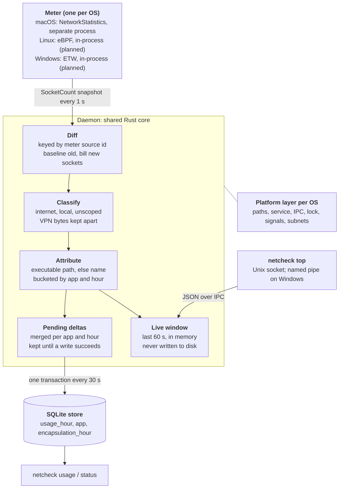

# netcheck — Design

Last updated: 2026-11-01

## Goal and scope

netcheck records how much each app sends and receives, split into internet, local network, and unscoped traffic, using a native, low-overhead background daemon. macOS ships first; Linux and Windows follow, then a GUI dashboard on the same data.

**In scope**

- Per-app totals by hour, kept locally in SQLite.
- A live view of the last minute (`netcheck top`).
- One shared core (diff, classification, storage, live window) with a native meter per OS.
- Runs unattended as a service, survives meter crashes, and restarts on login or boot.

**Out of scope for now**

- Packet capture, per-domain or per-URL breakdowns, and traffic shaping or blocking.
- Remote collection or multi-machine aggregation.
- Billing-grade accuracy. The target is trustworthy per-app totals, within a few seconds of start-up loss.

**Lowest overhead is the deciding criterion.** When designs compete, the one with less CPU, fewer wakeups and less memory wins, even if it adds a language such as C.

**Measured overhead (macOS):** measured with `scripts/overhead.py`. Three columns: the 1 s cadence (2026-11-01), the 10 s cadence with changed-only snapshots running as a user, and the same running as root (2026-11-02). As root the meter sees about twice as many sockets, every process's instead of one user's.

| Scenario | Process | CPU s/hour: 1 s → 10 s → root | Wakeups/s: 1 s → 10 s → root | Memory as root |
| --- | --- | --- | --- | --- |
| Idle, 120 s | meter | 9.2 → 1.0 → 2.4 | 0.98 → 0.19 → 0.18 | 2.6 MB |
| Idle, 120 s | daemon | 1.1 → 0.4 → 0.4 | 0 → 0 → 0 | 2.5 MB |
| Full-speed loopback stream, 60 s | meter | 8.1 → 1.8 → 3.0 | 0.98 → 0.13 → 0.20 | 2.6 MB |
| Full-speed loopback stream, 60 s | daemon | 1.0 → 0.3 → 0.4 | 0 → 0 → 0 | 2.6 MB |
| About 130 short connections/s, 60 s | meter | 168 → 178 → 178 | 0.95 → 0.10 → 0.10 | 12.1 MB |
| About 130 short connections/s, 60 s | daemon | 3.6 → 2.1 → 2.9 | 0 → 0 → 0 | 4.0 MB |

Memory is physical footprint. Wakeups are interrupt wakeups; package-idle wakeups stayed under 0.1/s throughout. While `top` keeps the meter at live cadence, it runs at about 1 wakeup/s and 12 CPU s/hour. Daemon disk writes are 14–20 KB/min: the status file every 10 s plus one SQLite transaction every 30 s.

Under connection churn the meter costs about 0.37 ms of CPU per new connection, roughly half user and half kernel time. The cadence and snapshot changes didn't touch that path. Profiling puts most of it outside netcheck's code, in NetworkStatistics' per-socket event handling.

**Measured overhead (Linux, OrbStack machine, 2026-11-02):** the same script, run with `sudo`. The daemon is one process; the probe row is kernel time inside the eBPF programs (with `kernel.bpf_stats_enabled` on during the run). Wakeups are voluntary context switches.

| Scenario | Daemon CPU s/hour | Probe CPU s/hour | Probe calls/s | Daemon wakeups/s | Daemon memory |
| --- | --- | --- | --- | --- | --- |
| Idle, 120 s | 0.30 | 0.02 | 3 | 0.13 | 6.1 MB |
| Full-speed loopback stream, 60 s | 0.00 | 28.6 | 309,000 | 0.13 | 6.3 MB |
| 200 short connections/s, 60 s | 3.6 | 4.9 | 1,000 | 0.13 | 7.3 MB |

That's about 26 ns per hooked call and 12 µs of CPU per connection, roughly 30 times less than the macOS meter. The daemon's disk writes are higher than on macOS, 150–200 KB/min against 14–20; not yet investigated.

## Current state: macOS v1

macOS v1 runs as a root LaunchDaemon (`com.netcheck.daemon`), so it sees every process's sockets. Its accounting was verified against known loopback transfers on 2026-11-01. Until then it ran as a per-user LaunchAgent, which only saw that user's processes (see the decision log).

**Linux** is built and passes the same conformance suite, so far only in an OrbStack machine on the Mac (see Testing): an eBPF probe counts bytes per socket in the kernel, and `sudo netcheck install` sets up a systemd service with a `netcheck` reader group. It hasn't run on a real Linux host yet.

| Command | What it does |
| --- | --- |
| `netcheck daemon` | Runs the meter and records usage (started by the LaunchDaemon) |
| `netcheck usage --since 24h [--app X] [--by-exe] [--links] [--json]` | Hourly totals per app (helpers included), per executable with `--by-exe`, or split by link with `--links` (Wi-Fi, wired, cellular, other, plus the VPN tunnel). JSON is `{apps, vpn_tunnel}` |
| `netcheck top [--json]` | Off-machine usage over the last 60 s, read from the daemon over a Unix socket |
| `netcheck status` | Meter state, last sample and flush times, stored row count |
| `sudo netcheck install` / `uninstall` | Installs or removes the LaunchDaemon and its binaries. Install retires the old per-user agent and copies its database |

**Accuracy checks (loopback, temp database)**

| Case | Before `315d2aa` | After |
| --- | --- | --- |
| 5 short 3 MB fetches by a process that predates the daemon | 0 B | 15 MB, plus the server's 15 MB sent |
| 30 MB transfer already running at daemon start | not tested | about 22.35 MB, only what arrived after start |
| `curl` started after the daemon | 3 MB | 3 MB |
| Second daemon on the same database | ran and double-counted | refused |

Files live in `/Library/Application Support/netcheck/` (`root:admin`, mode 0750): `netcheck.db`, `status.json`, `netcheck.sock` (0660), `netcheck.lock`, and `bin/`. The log is `/Library/Logs/netcheck.log`. Members of `admin` can read usage and run `top` without `sudo`.

## Architecture

A per-OS meter feeds socket snapshots to one shared daemon, which turns them into per-app usage. Only the meter and a thin platform layer differ between operating systems.



The daemon diffs each snapshot, classifies and attributes the bytes, then sends them two ways: to SQLite every 30 s for history, and to a 60 s in-memory window for `top`. If the meter crashes, the daemon restarts it with backoff and resets its flow state.

## Meter contract

Every meter delivers snapshots of `SocketCount` records with cumulative counters: every 10 s, or every second while someone is watching. Each snapshot holds only sockets that changed. That contract is what makes the core platform-independent, and it's written down as the `Meter` trait in `src/meter/mod.rs`. The NC02 byte frame is only how the macOS meter sends it.

| Field | Meaning | Rule |
| --- | --- | --- |
| `source` | Meter-assigned socket id | Unique for one meter run; never reused in that run |
| `new` | No bytes in these counters predate the meter | True for sockets opened after the first snapshot; false for sockets that already existed |
| `closed` | This is the socket's last report | Set once, with the final counters |
| `rx`, `tx` | Bytes received and sent | Cumulative from the later of socket open or meter start; never decrease |
| `pid`, `start_time` | Owning process and its start time (Unix s) | Captured when the meter first sees the socket |
| `path` | Executable path | Captured on first sight; absent if the process was already gone |
| `effective_pid`, `effective_path` | The process the socket works for, when that's another process (WebKit for Safari, `nsurlsessiond` for an app) | 0 and absent otherwise; the path is resolved on first sight, through the UUID cache if the process is gone |
| `links` | The same bytes split into Wi-Fi, wired and cellular, received and sent | Cumulative like `rx`/`tx`; bytes on a VPN tunnel, loopback or an unknown link are in the totals but none of these |
| `name` | Process name (up to 64 bytes) | Fallback identity when `path` is absent |
| `proto` | TCP or UDP | Other protocols are dropped |
| `local`, `remote` | Socket addresses | Latest known; may change during the socket's life; `remote` absent for unconnected UDP |

**Lifecycle rules**

1. A snapshot holds every socket on its first report, then only sockets whose counters changed. A socket missing from a snapshot is unchanged.
2. A closed socket is reported once more with `closed` set and its final counters, then never again. The daemon forgets a flow only then.
3. **Cadence:** the first snapshot comes about 1 s after the start, then every 10 s. For 60 s after any `top` request, the daemon switches the meter to every second. A slower cadence loses no bytes, because closed sockets wait for the next snapshot.
4. **Stopping:** before stopping, the daemon asks for one last snapshot (`snapshot_now`), so the final interval is kept. The macOS meter also takes a final snapshot itself on `SIGINT` or `SIGTERM`, which covers Ctrl-C in a terminal.
5. A meter restart starts a new run: ids restart, and the daemon resets its flow state (`Engine::reset_flows`).

**How the daemon turns this into usage:** first sight of a `new` socket bills its full counters; first sight of an old socket records a baseline; every later sight bills the increase. Event-based meters (Linux eBPF, Windows ETW) satisfy the contract by summing deltas per socket from attach time and marking every socket `new`.

**NC03 frame (macOS):** a `NC03` magic header, then length-prefixed messages: snapshot start (a flag marks a requested snapshot), one socket record per reported socket (194 fixed bytes, then the path and the effective process's path, each up to 4,096 bytes; flag bits for `new` and `closed`), and snapshot end with a count. Little-endian throughout. The daemon controls the meter with one-byte commands on its stdin: `l` live cadence, `i` idle cadence, `n` snapshot now. When stdin closes, the meter exits.

## Data model and storage

Usage is stored as per-app hourly buckets in SQLite (WAL, `synchronous=NORMAL`), so the database stays small and queries stay simple. The cost is that `usage --since` rounds out to whole hours.

| Table | Key | Columns |
| --- | --- | --- |
| `app` | `id`; `app_key` unique | `display_name`, `group_key` (indexed), `group_name` |
| `usage_hour` | (`app_id`, `hour_utc`) | `internet_rx/tx`, `local_rx/tx`, `unscoped_rx/tx`, and the same bytes by link: `wifi_rx/tx`, `wired_rx/tx`, `cellular_rx/tx` |
| `encapsulation_hour` | `hour_utc` | `rx`, `tx` and the same link columns: VPN tunnel bytes kept out of app totals, and which physical links carried them |

- **App identity:** `app_key` is the executable path. With no path, it's `name:<process name>`, so short-lived processes still group. 21 older `pid:<pid>:<start>` rows from before `315d2aa` remain and are grouped by process name.
- **App grouping:** `group_key` is the outermost `.app` or `.appex` bundle in the path, so helpers count toward their app (`/Applications/Claude.app` → Claude). Other executables are their own group. Grouping rules for Linux and Windows aren't written yet. `usage` and `top` show groups; `usage --by-exe` shows executables.
- **Durability:** deltas are merged in memory per app and hour, then written every 30 s in one transaction. A failed write keeps them for the next try. Up to 30 s is lost on a crash or `SIGKILL`.
- **Off-machine** = internet + unscoped. It's what `top` shows and what the default `usage` sort uses.
- **Schema versioning:** the version lives in `PRAGMA user_version` (currently 3). The daemon applies ordered migrations on start, each in its own transaction. The CLI opens read-only and refuses an old schema with "restart the daemon". v1 is the original tables; v2 adds the group columns and fills them for existing rows; v3 adds the link columns.
- **No retention policy.** At roughly 100 apps × 24 hours, that's about 2,400 small rows a day, so growth is slow but unbounded.

## Classification and attribution

Each socket's bytes go to one scope based on its remote address, and to one app based on its executable path.

| Scope | Rule |
| --- | --- |
| Local | Remote is loopback, RFC 1918 private, link-local, multicast, broadcast, unspecified, IPv6 ULA (`fc00::/7`) or link-local (`fe80::/10`), or inside a subnet configured on this machine (refreshed every 60 s) |
| Local (no remote) | Local port is DHCP 68, NetBIOS 137/138, SSDP 1900, or mDNS 5353 |
| Unscoped | No remote address and none of those ports, typically unconnected UDP |
| Internet | Everything else |

**VPN encapsulation:** traffic from processes named `mullvad-daemon`, `mullvad vpn`, `openvpn`, `wireguard-go`, `wireguard`, `wg` or `kvpncsvc` goes to `encapsulation_hour`, not to app totals. The tunnelled traffic is already counted under the apps that sent it, so this avoids counting it twice. These daemons run as root, so this only works since the meter runs as root. Behind a VPN, apps' own link columns read as other (the tunnel); the tunnel row shows which physical link carried it.

**Known attribution gaps**

- **Helper processes outside bundles:** helpers inside an `.app` now group with it on macOS, but standalone binaries and Linux and Windows processes don't group yet.
- **Delegated traffic:** some apps hand networking to another process, such as Safari to `com.apple.WebKit.Networking` or background transfers to `nsurlsessiond`. The meter now credits these sockets to the effective process, but no delegated socket has been observed yet to confirm it end to end.
- **Shared interpreters:** every Python or Node script lands under one interpreter row.
- **CGNAT and Tailscale:** peers in `100.64.0.0/10` count as internet, and they're double-counted against `tailscaled`'s own sockets. `tailscaled` isn't on the exclude list.
- **Fixed exclude list:** it's hard-coded and matches process names only.

## Platform plans

Each OS gets the one source that sees every socket, including UDP and connections shorter than a poll. On every OS that source needs root or admin to see other users' and system processes, so the daemon runs as a system service. Linux and Windows details are from API knowledge and haven't been prototyped.

|  | macOS (shipped) | Linux (built; tested in OrbStack) | Windows (planned) |
| --- | --- | --- | --- |
| Source | NetworkStatistics (private framework) | eBPF `fexit` on `tcp_sendmsg`, `tcp_recvmsg`, `udp_sendmsg`, `udp_recvmsg`, `udpv6_sendmsg`, `udpv6_recvmsg` | ETW `Microsoft-Windows-Kernel-Network` |
| Data shape | Cumulative per socket | Bytes added per call into an LRU hash map keyed by socket cookie, read in one batch per snapshot | Per-event deltas, summed per connection |
| Socket id | Meter counter | Socket cookie (unique per boot) | Meter counter per 5-tuple and PID |
| Close signal | Removed callback | `fentry/inet_release` marks the entry closed; the daemon deletes it after reporting | Disconnect event |
| Privilege | Root (as a user it sees only that user's processes) | Root (`CAP_BPF`, `CAP_PERFMON`) | Administrator |
| Minimum | macOS 13+ assumed | Kernel with BTF and `bpf_get_func_ret`: 5.17+ on x86_64, 6.0+ on arm64. No kprobe fallback yet | Windows 10 1809+ assumed |
| Runs as | LaunchDaemon | systemd system unit | Windows service |
| Meter process | Separate (Objective-C) | In-process: probe in C (`meter/linux/netcheck.bpf.c`) loaded with `libbpf-rs` | In-process Rust; consumer design open (decision 6) |

**Rejected sources:** Linux `sock_diag` polling (no UDP byte counters, misses short connections); Windows TCP ESTATS (TCP only, polled), WFP callout drivers (need a signed kernel driver), and SRUM (hourly and delayed).

**Platform layer:** these pieces sit behind one small interface in `src/platform/`, with one module per OS. macOS is complete. macOS and Linux are complete; Linux installs a systemd unit (`/etc/systemd/system/netcheck.service`, binary in `/usr/local/lib/netcheck`, linked from `/usr/local/bin`) and creates the `netcheck` group. The Windows module is a stub that returns "not supported yet" and hasn't been compiled. The instance lock uses `std::fs::File::try_lock` on every OS.

| Concern | macOS | Linux | Windows |
| --- | --- | --- | --- |
| Data directory | `/Library/Application Support/netcheck` | `/var/lib/netcheck` | `%ProgramData%\netcheck` |
| Service install | `launchctl bootstrap system` | systemd unit | Service Control Manager |
| IPC for `top` | Unix socket | Unix socket | Named pipe |
| Reader group | `admin` (exists on every Mac) | `netcheck` (install creates it) | to be decided |
| Instance lock | `flock` | `flock` | `LockFileEx` or a named mutex |
| Stop signal | `SIGINT`, `SIGTERM` | `SIGINT`, `SIGTERM` | Service control handler |
| Local subnets | `getifaddrs` | `getifaddrs` | `GetAdaptersAddresses` |
| App grouping | `.app` bundle | Not yet: executables are their own app (planned: systemd `app-*.scope`, Flatpak id) | Package family name, service name |

**Platform-specific traps**

- **Linux:** kernel WireGuard has no process, so nothing to exclude. Containerised processes need `/proc/<pid>/root` to resolve paths.
- **Windows:** ETW can drop events under load, so the status file should report lost events. Some traffic is credited to PID 4 (System), such as SMB. `svchost.exe` needs service-level attribution.

## Decision log

These are settled unless new evidence reopens them. Newest first.

| When | Decision | Why | Rejected |
| --- | --- | --- | --- |
| Built 2026-11-02 | Linux meter: a C eBPF probe loaded in-process with `libbpf-rs`. `fexit` hooks read each call's return value with `bpf_get_func_ret` and add it to a per-socket entry in an LRU hash keyed by socket cookie; `inet_release` marks closes; a ring buffer reports each new process so its path is read while it exists; the daemon reads the map in one batch per snapshot | Counting in the kernel and reading every 10 s keeps wakeups near zero; measured at about 26 ns per hooked call and 12 µs per connection | `fentry` on `tcp_cleanup_rbuf` for receives, which runs twice in a blocking read with the cumulative count; reading the return as declared arguments, which breaks when a kernel changes the signature; Aya; a vendored `vmlinux.h` (minimal CO-RE struct definitions instead) |
| Built 2026-11-02 | When the daemon runs in a nested PID namespace (a container, such as an OrbStack machine), the probe also records each process's PID in that namespace with `bpf_get_ns_current_pid_tgid` | The kernel's global PID doesn't exist in the daemon's `/proc` there, so paths failed and PIDs were wrong. On a normal host the daemon is in the root namespace and global PIDs are used | Always using global PIDs |
| Built 2026-11-02 | macOS runs as a root LaunchDaemon, replacing the per-user LaunchAgent; install copies the old database | Probing showed NetworkStatistics as a user sees only that user's processes: 10 of 10 were the user's. As root it saw 21, including root, `_mdnsresponder` and `_netbios`. VPN daemons, DNS and system services were uncounted | Staying user-level |
| Built 2026-11-02 | Each socket carries its effective process and its bytes split by link (Wi-Fi, wired, cellular); usage credits the effective process and stores the link split for apps and for the VPN tunnel | Contract changes are cheapest while there is one meter. NetworkStatistics reports `epid`, `euuid` and per-link counters | Only an interface flag per socket, which misreads sockets that move between links |
| Built 2026-11-01 | Snapshot every 10 s, or every second for 60 s after a `top` request; one final snapshot on stop | The meter's 1 s timer was its main idle cost, and closed sockets wait for the next snapshot, so a slower cadence loses nothing | A fixed 1 s interval |
| Built 2026-11-01 | Snapshots hold only changed sockets, plus one `closed` report per socket | Most sockets are idle in any interval; re-sending them cost meter and daemon work every snapshot | Complete snapshots |
| Decided 2026-11-01 | Lowest runtime overhead decides between designs; other languages (C or others) are allowed where they lower it | A native, low-overhead daemon is the product goal | A single-language codebase as a constraint |
| Decided 2026-11-01 | No CI for now; the conformance suite runs locally | Not worth the setup at this stage | A GitHub Actions matrix |
| Built 2026-11-01 (macOS) | The daemon runs as a system service with a system-wide database readable by a reader group (`admin` on macOS, `netcheck` on Linux); the socket has the same group | Every OS needs root to see other users' and system processes; a group keeps reads off root without a second process | Privileged meter feeding a per-user daemon; root-only reads |
| Built 2026-11-01 | The macOS meter records each executable's UUID with its path, and uses it to name processes that exit before their path can be read | The conformance suite showed a process living under one poll lost its path in 2 of 3 runs | A process-name lookup, which can't tell two binaries with the same name apart |
| Built 2026-11-01 (macOS) | Linux and Windows meters run in-process behind a `Meter` trait; the macOS subprocess becomes one implementation of it | Privilege separation was the main reason for a separate process, and the service model doesn't need it | A separate meter process on every OS |
| Built 2026-11-01 | Schema versioning with `PRAGMA user_version` and ordered migrations, plus a `group_key` column set at write beside the raw `app_key` | Only one database to migrate today; the GUI needs grouping | Grouping applied at query time only |
| Decided 2026-11-01 | Linux is the next platform, then Windows | eBPF matches the meter contract directly, and Ubuntu CI runners can run it with `sudo` | Windows first |
| `315d2aa` | Key flows by meter source id, not by address tuple | Addresses change during a socket's life; a tuple key split or dropped flows | 5-tuple plus PID key |
| `315d2aa` | The meter flags sockets opened after its first snapshot as `new`; the daemon bills their full counters | Only sockets that predate the meter need a baseline; the old rule lost short connections from long-running apps | Baseline every first sight; bill by process start time |
| `315d2aa` | The meter captures path and start time on first sight | Short-lived processes exit before the daemon can look them up | Daemon-side `proc_pidpath` lookup |
| `315d2aa` | Single instance per database via `flock` | Two daemons silently stole the socket and double-counted | PID file |
| `315d2aa` | Pending deltas merged per app-hour, flushed in one transaction, kept on failure | No loss or double counting on database errors; bounded memory during an outage | Per-hour transactions; drop on failure |
| `315d2aa` | `install` stops the agent, then replaces binaries by rename | Writing into a running Mach-O on arm64 leaves a stale code signature, and the next launch is killed | In-place copy |
| `a2cc1b7` | Live `top` window kept in memory and served over a Unix socket | Avoids per-second database writes | Querying SQLite for live data |
| `a2cc1b7` | Per-user LaunchAgent on macOS (reversed 2026-11-02) | Assumed NStat sees every user's sockets without root; it doesn't | LaunchDaemon (root) |
| `6dd9026` | Meter as a separate process that streams frames | Isolates the private Objective-C framework; a crash restarts only the meter | Linking NStat into the Rust binary |
| `6dd9026` | Hourly buckets in SQLite, three scopes, VPN bytes kept apart | Small and simple to query; scopes answer "what went to the internet" | Per-flow rows; a time-series database |

## Open decisions

Decision 6 shapes the Windows meter, so settle it before that port. Decision 2 should be settled before the GUI starts, since it shapes the IPC API. The recommendations are proposals, not decisions.

| # | Decision | Options | Recommendation | Blocks |
| --- | --- | --- | --- | --- |
| 2 | How the GUI reads data | Directly from SQLite; through a versioned daemon API over IPC | Daemon API, so the schema can change underneath | IPC design, GUI |
| 3 | Configuration | Hard-coded defaults; a `netcheck.toml` in the data directory | TOML with per-OS defaults; add `tailscaled` and tunnel handling | Exclude list, retention |
| 4 | Retention | Keep forever; roll up to daily totals after N days | Defer; revisit when the database passes about 50 MB | Nothing yet |
| 6 | Windows ETW consumer | `ferrisetw` (decodes each event by schema lookup, TDH); the raw `windows` crate with fixed layouts parsed by hand. Source: the `Microsoft-Windows-Kernel-Network` provider or the classic kernel logger's TCP/IP flag | Raw `windows` crate, hand-parsed, TCP and UDP events only; choose the source by measuring both | Windows meter |

## Testing and verification

The core has 36 unit tests with synthetic samples. Every meter must also pass the conformance suite in `tests/conformance.rs`: real loopback traffic through a real daemon, checked to the byte. It's ignored by default because it takes about 13 s and needs the OS meter:

```bash
cargo test --release --test conformance -- --ignored --test-threads=1
```

**Cases:**

1. Short connections from a process that predates the daemon are counted in full, on both client and server.
2. A connection already transferring at daemon start is billed only for bytes after start.
3. A process started after the daemon is counted to the byte.
4. Unconnected UDP to alternating peers is counted once.
5. A process that exits within one poll still gets its path or name.
6. A second daemon on the same database is refused.
7. Killing the meter mid-run causes no double counting after it restarts.

Cases 1–6 are automated and passed 10 runs in a row on macOS on 2026-11-01. Case 7 isn't automated yet. Reintroducing the old baseline bug makes the suite fail, so it does catch regressions.

**CI:** deferred. The unit tests and each OS's conformance suite run locally. GitHub Actions runners can run eBPF (Ubuntu with `sudo`) and ETW (Windows as administrator) when CI is added.

**Linux development environment:** an OrbStack machine on the Mac, `netcheck` (Ubuntu 24.04, arm64, created 2026-11-02). It runs OrbStack's kernel, 7.2.12, with BTF, the BPF JIT, direct-call ftrace (needed for `fentry`) and kprobes. Toolchain: Rust 1.99.1, clang 18, libbpf 1.3, and bpftool 7.4 from Ubuntu's `linux-tools-generic` (linked to `/usr/local/sbin/bpftool`). The repo is visible at the same path, and `orb` keeps the current directory, so run it from the repo on the Mac. Build with `CARGO_TARGET_DIR=$HOME/netcheck-target` so Linux and macOS builds stay apart:

```bash
orb -m netcheck sh -c 'CARGO_TARGET_DIR=$HOME/netcheck-target cargo test --release'
```

Findings from setting it up:

- A first minimal `fexit` probe on `tcp_sendmsg` and `udp_sendmsg`, counting into a hash map keyed by socket cookie, loaded, attached, and counted 1,000,000 TCP and 50,000 UDP bytes exactly.
- All planned hooks are traceable on this kernel: `tcp_sendmsg`, `tcp_recvmsg`, `tcp_cleanup_rbuf` (also present as `__tcp_cleanup_rbuf`), `udp_sendmsg`, `udp_recvmsg`, `udpv6_sendmsg`, `udpv6_recvmsg`. Socket close is the `sock/inet_sock_set_state` tracepoint. Hook names drift between kernels, so the meter should try alternatives.
- The machine only sees its own traffic. That's enough for development and the conformance suite, but the meter must also pass on an older LTS kernel (5.15, 6.1 or 6.8) and on x86_64 before it ships, because OrbStack's kernel is far newer than most hosts.
- OrbStack runs a few BPF programs of its own (`fexit` and LSM). They're unrelated to netcheck.
- bpftool 7.4 is older than the kernel, so the generated `vmlinux.h` produces harmless "declaration does not declare anything" warnings.
- An OrbStack machine is a container: its PID namespace isn't the root one, which is why the probe records namespace-local PIDs. Processes outside it (OrbStack's own `scon`, `krpc`, `nfsd`, which share the VM kernel) show up by process name only.

On Linux the conformance suite needs root. Build it, then run the test binary with `sudo`; it passed 10 runs in a row. `meter::linux::tests::probe_counts_its_own_loopback_transfer` is a faster root-only check of the probe alone:

```bash
orb -m netcheck sh -c 'CARGO_TARGET_DIR=$HOME/netcheck-target cargo test --release --test conformance --no-run'
orb -m netcheck sh -c 'sudo $(ls -t $HOME/netcheck-target/release/deps/conformance-* | grep -v "\.d$" | head -1) --ignored --test-threads=1'
```

**Overhead measurement:** CPU seconds per hour, wakeups per second, disk writes and memory for the daemon and meter. Three scenarios: idle, a full-speed loopback stream, and connection churn. On macOS, `scripts/overhead.py` reads each process's counters with `proc_pid_rusage`, which needs no root, and measures the installed agent:

```bash
python3 -I scripts/overhead.py --idle 120 --load 60 --rate 200
```

The churn generator reports the rate it achieved, because loopback connects occasionally stall at high rates. Compare churn runs per connection, not per hour. On Linux, `bpftool prog show` reports probe time in the kernel once `kernel.bpf_stats_enabled` is on.

## Known limitations and risks

The largest risk is that macOS depends on a private framework. The rest are bounded losses or attribution gaps.

| Risk or limitation | Impact | Mitigation |
| --- | --- | --- |
| NetworkStatistics is private and undocumented | A macOS update could break or change it without notice | Conformance suite run on each macOS beta; meter failures show in `status` |
| Sockets opened in the meter's first second are baselined | A small undercount at every daemon or meter start | Acceptable; could be narrowed with a socket start time if NStat exposes one |
| Up to 30 s of deltas lost on a crash or `SIGKILL` | Small undercount | Shorter flush interval if needed |
| Bytes after the last poll of a closing socket | Checked on macOS: short TCP connections are counted to the byte by the conformance suite | Keep the case in the suite for every meter |
| A binary's first run exits before its path is read | Recorded under `name:<process>` until the meter has seen that binary alive once | UUID cache in the meter; the cache resets when the meter restarts |
| Attribution gaps (standalone helpers, interpreters, CGNAT) | Usage credited to the wrong row, or counted twice for Tailscale | App grouping and effective-process attribution (built); open decision 3 |
| Every meter needs root or admin | Install needs `sudo`; data is readable only by the reader group | Decided and built on macOS: system service with a reader group |
| ETW event loss under load | Undercount on busy Windows machines | Report lost events in `status` |
| Meter cost grows with connection churn | About 0.37 ms CPU per new connection on macOS, roughly 5% of a core at 130 connections/s | Not yet addressed. Leads: skip the path syscalls when the UUID cache already knows the binary; check whether NetworkStatistics filters can drop loopback sockets in the kernel (that would stop counting loopback traffic) |
| Stopping can take up to one idle interval | The daemon notices a stop only when the next snapshot arrives, up to 10 s; launchd allows 20 s | Acceptable for now. That snapshot already holds the last interval, so nothing is lost |

| No metered flag observed | NetworkStatistics may report an "expensive" (metered) flag, but every socket here was on a VPN tunnel, so none showed it. Cellular bytes are stored; a hotspot over Wi-Fi isn't yet marked as metered | Check on a machine without a VPN, or on a hotspot |
| Linux meter only tested in OrbStack | One very new kernel (7.2, arm64), and no real host's traffic | Run on an LTS kernel (5.15, 6.1 or 6.8) and on x86_64 before shipping |
| No link split or effective process on Linux | The Linux probe doesn't report Wi-Fi, wired or cellular bytes, or delegated traffic; those columns stay zero | Add interface lookup to the probe if needed |
| Linux daemon writes 150–200 KB/min to disk | Ten times the macOS figure | Investigate: SQLite page writes, checkpoints, or the status file |